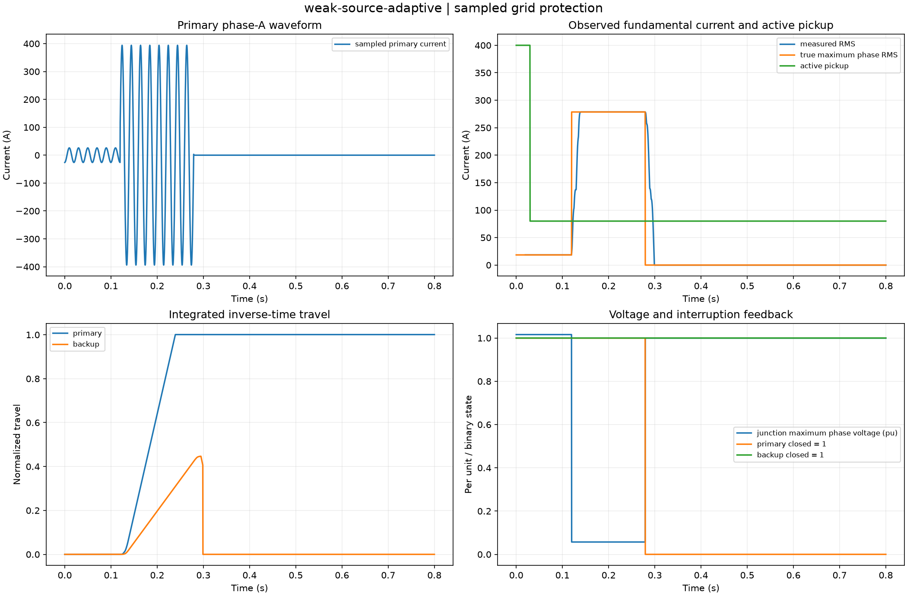
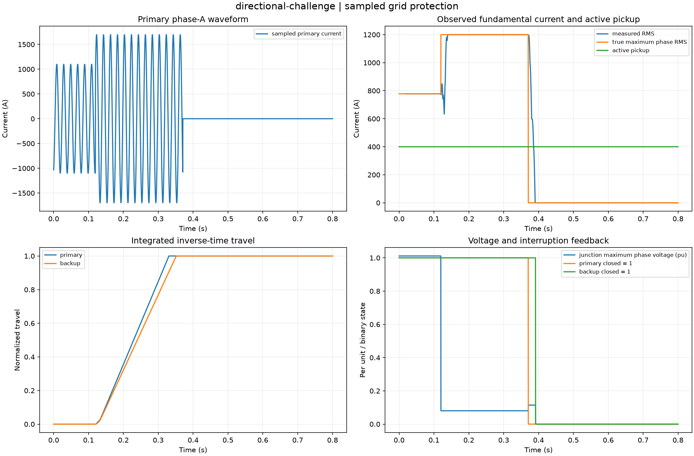
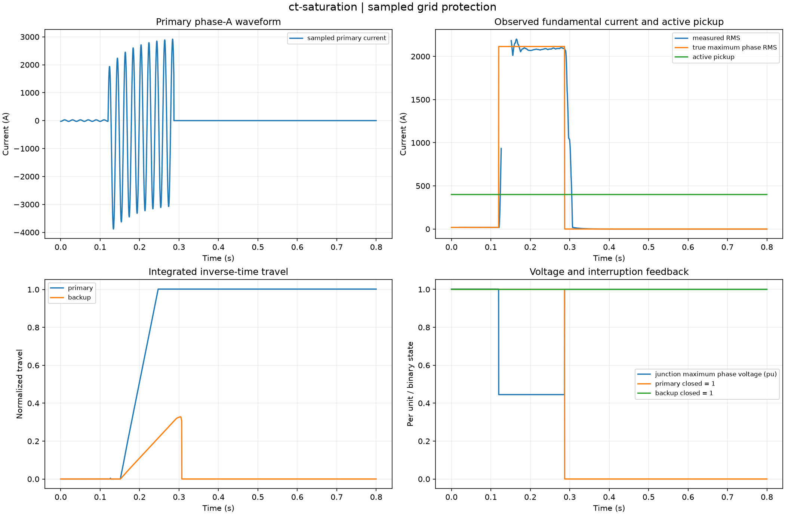
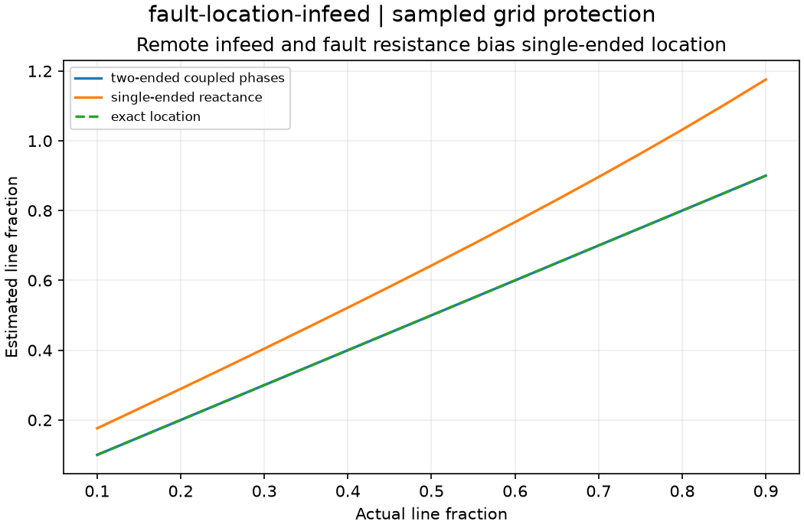
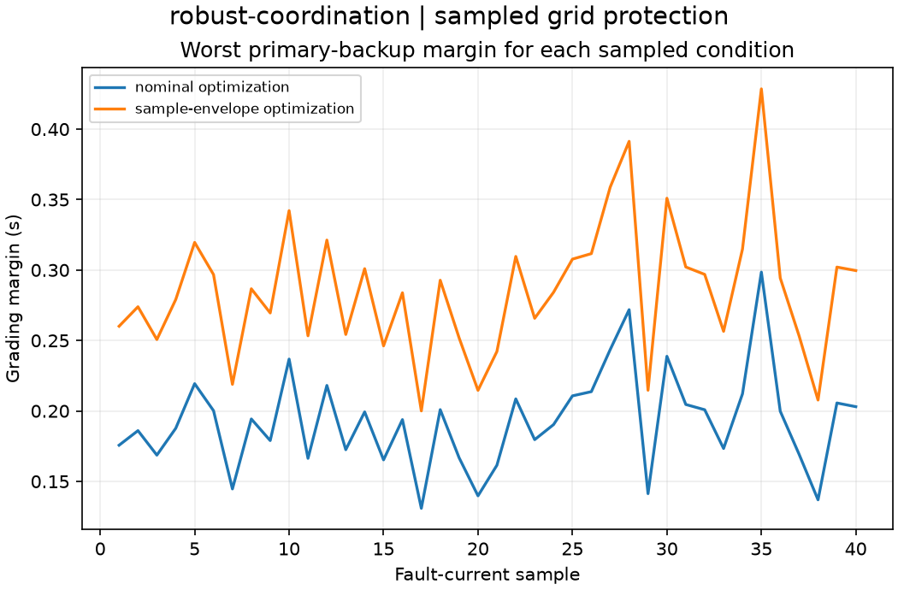

# Measured experiment gallery

Twenty-seven default studies computed from clean source revision [`b6841e1232dc`](https://github.com/VictorOdoyo/adaptive-grid-protection/commit/b6841e1232dcac6db840a727ea4b1e98340b98a7).
All values below come from the sealed captures. Each case directory contains the complete
NPZ arrays, CSV tables, parameters, provenance, plot and HTML report.

HTML files can be opened locally; GitHub previews the figures and tables directly.

| Study | Selected measured outputs | Artifacts |
| --- | --- | --- |
| [strong-source](gallery/strong-source/figure.png) | selective = True; clearing_delay_s = 0.144062; unnecessary_openings = 0 | [summary](gallery/strong-source/summary.csv), [setup](gallery/strong-source/parameters.json), [archive](gallery/strong-source/fields.npz), [report](gallery/strong-source/index.html) |
| [weak-source-static](gallery/weak-source-static/figure.png) | selective = False; clearing_delay_s = None; unnecessary_openings = 0 | [summary](gallery/weak-source-static/summary.csv), [setup](gallery/weak-source-static/parameters.json), [archive](gallery/weak-source-static/fields.npz), [report](gallery/weak-source-static/index.html) |
| [weak-source-adaptive](gallery/weak-source-adaptive/figure.png) | selective = True; clearing_delay_s = 0.159375; unnecessary_openings = 0 | [summary](gallery/weak-source-adaptive/summary.csv), [setup](gallery/weak-source-adaptive/parameters.json), [archive](gallery/weak-source-adaptive/fields.npz), [report](gallery/weak-source-adaptive/index.html) |
| [earth-fault-adaptive](gallery/earth-fault-adaptive/figure.png) | selective = True; clearing_delay_s = 0.309375; unnecessary_openings = 0 | [summary](gallery/earth-fault-adaptive/summary.csv), [setup](gallery/earth-fault-adaptive/parameters.json), [archive](gallery/earth-fault-adaptive/fields.npz), [report](gallery/earth-fault-adaptive/index.html) |
| [phase-fault-adaptive](gallery/phase-fault-adaptive/figure.png) | selective = True; clearing_delay_s = 0.185625; unnecessary_openings = 0 | [summary](gallery/phase-fault-adaptive/summary.csv), [setup](gallery/phase-fault-adaptive/parameters.json), [archive](gallery/phase-fault-adaptive/fields.npz), [report](gallery/phase-fault-adaptive/index.html) |
| [instrumented-fault](gallery/instrumented-fault/figure.png) | selective = True; clearing_delay_s = 0.140313; unnecessary_openings = 0 | [summary](gallery/instrumented-fault/summary.csv), [setup](gallery/instrumented-fault/parameters.json), [archive](gallery/instrumented-fault/fields.npz), [report](gallery/instrumented-fault/index.html) |
| [ct-saturation](gallery/ct-saturation/figure.png) | selective = True; clearing_delay_s = 0.167187; unnecessary_openings = 0 | [summary](gallery/ct-saturation/summary.csv), [setup](gallery/ct-saturation/parameters.json), [archive](gallery/ct-saturation/fields.npz), [report](gallery/ct-saturation/index.html) |
| [adc-clipping](gallery/adc-clipping/figure.png) | selective = False; clearing_delay_s = None; unnecessary_openings = 0 | [summary](gallery/adc-clipping/summary.csv), [setup](gallery/adc-clipping/parameters.json), [archive](gallery/adc-clipping/fields.npz), [report](gallery/adc-clipping/index.html) |
| [breaker-failure](gallery/breaker-failure/figure.png) | selective = True; clearing_delay_s = 0.264062; unnecessary_openings = 0 | [summary](gallery/breaker-failure/summary.csv), [setup](gallery/breaker-failure/parameters.json), [archive](gallery/breaker-failure/fields.npz), [report](gallery/breaker-failure/index.html) |
| [directional-challenge](gallery/directional-challenge/figure.png) | selective = False; clearing_delay_s = 0.271562; unnecessary_openings = 1 | [summary](gallery/directional-challenge/summary.csv), [setup](gallery/directional-challenge/parameters.json), [archive](gallery/directional-challenge/fields.npz), [report](gallery/directional-challenge/index.html) |
| [healthy-export](gallery/healthy-export/figure.png) | selective = True; clearing_delay_s = None; unnecessary_openings = 0 | [summary](gallery/healthy-export/summary.csv), [setup](gallery/healthy-export/parameters.json), [archive](gallery/healthy-export/fields.npz), [report](gallery/healthy-export/index.html) |
| [temporary-fault](gallery/temporary-fault/figure.png) | selective = True; clearing_delay_s = None; unnecessary_openings = 0 | [summary](gallery/temporary-fault/summary.csv), [setup](gallery/temporary-fault/parameters.json), [archive](gallery/temporary-fault/fields.npz), [report](gallery/temporary-fault/index.html) |
| [fault-reference-benchmarks](gallery/fault-reference-benchmarks/figure.png) | maximum_relative_error = 4.64391e-16 | [summary](gallery/fault-reference-benchmarks/summary.csv), [setup](gallery/fault-reference-benchmarks/parameters.json), [archive](gallery/fault-reference-benchmarks/fields.npz), [report](gallery/fault-reference-benchmarks/index.html) |
| [inverter-current-ceilings](gallery/inverter-current-ceilings/figure.png) | limit_excess_a = 1.42109e-14; maximum_phase_current_a = 120 | [summary](gallery/inverter-current-ceilings/summary.csv), [setup](gallery/inverter-current-ceilings/parameters.json), [archive](gallery/inverter-current-ceilings/fields.npz), [report](gallery/inverter-current-ceilings/index.html) |
| [negative-sequence-observability](gallery/negative-sequence-observability/figure.png) | full_gain_current_a = 9.26806; zero_gain_observable = False | [summary](gallery/negative-sequence-observability/summary.csv), [setup](gallery/negative-sequence-observability/parameters.json), [archive](gallery/negative-sequence-observability/fields.npz), [report](gallery/negative-sequence-observability/index.html) |
| [dc-offset-rejection](gallery/dc-offset-rejection/figure.png) | maximum_valid_mimic_error = 7.25233e-15; maximum_valid_raw_error = 0.0461325 | [summary](gallery/dc-offset-rejection/summary.csv), [setup](gallery/dc-offset-rejection/parameters.json), [archive](gallery/dc-offset-rejection/fields.npz), [report](gallery/dc-offset-rejection/index.html) |
| [off-nominal-estimation](gallery/off-nominal-estimation/figure.png) | estimated_frequency_hz = 48.7; fitted_phasor_relative_error = 1.25735e-07 | [summary](gallery/off-nominal-estimation/summary.csv), [setup](gallery/off-nominal-estimation/parameters.json), [archive](gallery/off-nominal-estimation/fields.npz), [report](gallery/off-nominal-estimation/index.html) |
| [ct-burden-sensitivity](gallery/ct-burden-sensitivity/figure.png) | high_burden_saturated_fraction = 0.789268; low_burden_saturated_fraction = 0 | [summary](gallery/ct-burden-sensitivity/summary.csv), [setup](gallery/ct-burden-sensitivity/parameters.json), [archive](gallery/ct-burden-sensitivity/fields.npz), [report](gallery/ct-burden-sensitivity/index.html) |
| [coordination-optimization](gallery/coordination-optimization/figure.png) | minimum_margin_s = 0.2; objective_sum_tms = 0.325657 | [summary](gallery/coordination-optimization/summary.csv), [setup](gallery/coordination-optimization/parameters.json), [archive](gallery/coordination-optimization/fields.npz), [report](gallery/coordination-optimization/index.html) |
| [robust-coordination](gallery/robust-coordination/figure.png) | nominal_settings_worst_margin_s = 0.130882; robust_settings_worst_margin_s = 0.2 | [summary](gallery/robust-coordination/summary.csv), [setup](gallery/robust-coordination/parameters.json), [archive](gallery/robust-coordination/fields.npz), [report](gallery/robust-coordination/index.html) |
| [differential-security](gallery/differential-security/figure.png) | external_false_pickups = 0; harmonic_block_threshold = 0.15 | [summary](gallery/differential-security/summary.csv), [setup](gallery/differential-security/parameters.json), [archive](gallery/differential-security/fields.npz), [report](gallery/differential-security/index.html) |
| [distance-resistive-reach](gallery/distance-resistive-reach/figure.png) | mho_detected_points = 36; quadrilateral_detected_points = 146 | [summary](gallery/distance-resistive-reach/summary.csv), [setup](gallery/distance-resistive-reach/parameters.json), [archive](gallery/distance-resistive-reach/fields.npz), [report](gallery/distance-resistive-reach/index.html) |
| [fault-location-infeed](gallery/fault-location-infeed/figure.png) | maximum_single_ended_error = 0.275524; maximum_two_ended_error = 2.22045e-16 | [summary](gallery/fault-location-infeed/summary.csv), [setup](gallery/fault-location-infeed/parameters.json), [archive](gallery/fault-location-infeed/fields.npz), [report](gallery/fault-location-infeed/index.html) |
| [pilot-channel-latency](gallery/pilot-channel-latency/figure.png) | available_points = 21; unavailable_points = 20 | [summary](gallery/pilot-channel-latency/summary.csv), [setup](gallery/pilot-channel-latency/parameters.json), [archive](gallery/pilot-channel-latency/fields.npz), [report](gallery/pilot-channel-latency/index.html) |
| [adaptive-transition-guards](gallery/adaptive-transition-guards/figure.png) | commit_time_s = 0.22; committed_during_fault = False | [summary](gallery/adaptive-transition-guards/summary.csv), [setup](gallery/adaptive-transition-guards/parameters.json), [archive](gallery/adaptive-transition-guards/fields.npz), [report](gallery/adaptive-transition-guards/index.html) |
| [current-zero-interruption](gallery/current-zero-interruption/figure.png) | additional_arc_wait_s = 0.0088125; opening_time_s = 0.0588125 | [summary](gallery/current-zero-interruption/summary.csv), [setup](gallery/current-zero-interruption/parameters.json), [archive](gallery/current-zero-interruption/fields.npz), [report](gallery/current-zero-interruption/index.html) |
| [pickup-uncertainty](gallery/pickup-uncertainty/figure.png) | conditional_mean_ci_high_s = 10.6982; conditional_mean_ci_low_s = 4.30543 | [summary](gallery/pickup-uncertainty/summary.csv), [setup](gallery/pickup-uncertainty/parameters.json), [archive](gallery/pickup-uncertainty/fields.npz), [report](gallery/pickup-uncertainty/index.html) |

## Selected fields and diagnostics

### weak-source-adaptive

### directional-challenge

### ct-saturation

### fault-location-infeed

### robust-coordination

## Interpretation

Use each report's assumptions before interpreting the figures. Small algebraic residuals,
current-control residuals and measured relay timing are different diagnostics. Protection failures
are deliberately retained in weak-source-static, adc-clipping and directional-challenge.
The feeder uses a quasi-steady network with sampled waveforms; these are not hardware measurements.

Reproduce with `protectlab batch --data-only --output outputs/catalog`, then
`protectlab render outputs/catalog` and `protectlab verify outputs/catalog`.
Replay an individual archive with `protectlab replay ARCHIVE --output DIRECTORY`.
Replay retains this source revision rather than claiming a fresh solve.
